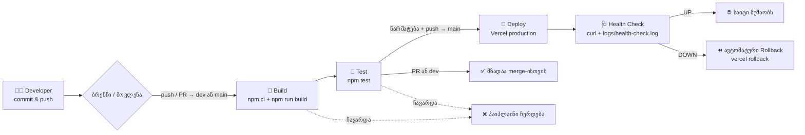
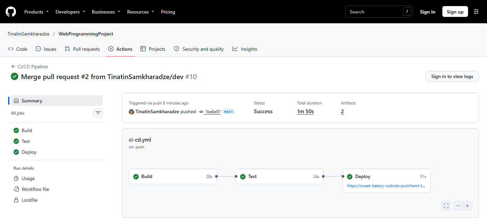
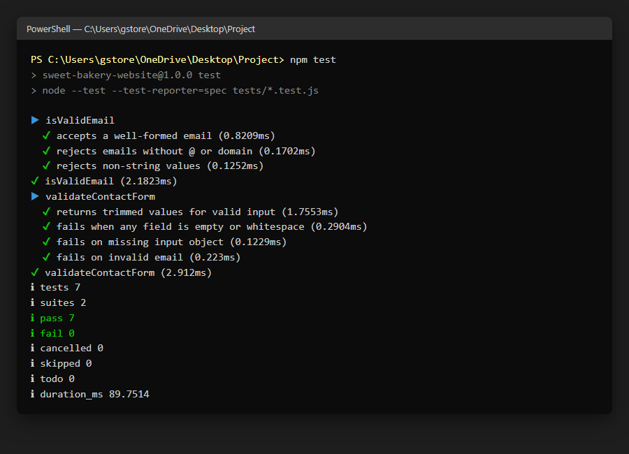
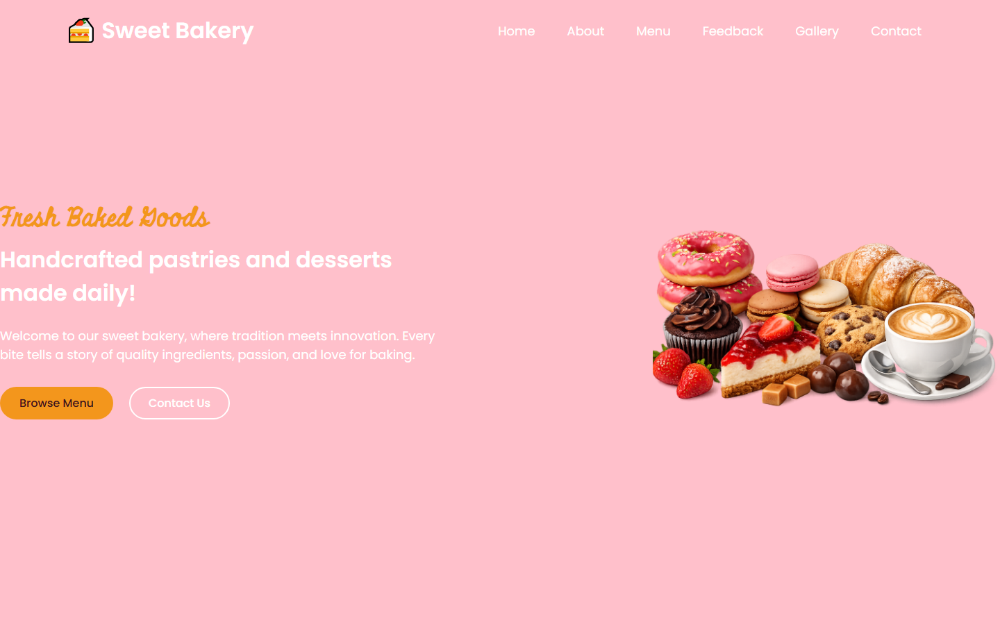
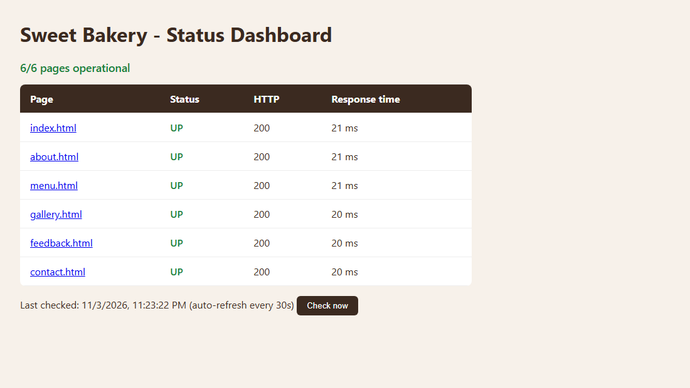

# Sweet Bakery – DevOps პროექტი


🔗 **Live ვერსია (Vercel):** https://sweet-bakery-website-chi.vercel.app
📊 **სტატუსის დეშბორდი:** https://sweet-bakery-website-chi.vercel.app/status.html

## 1. პროექტის აღწერა

**Sweet Bakery** არის საცხობის რესპონსიული, მრავალგვერდიანი სტატიკური ვებ-გვერდი (HTML/CSS/JavaScript).
საიტზე არის მთავარი გვერდი, მენიუ, გალერეა, „ჩვენ შესახებ“, მომხმარებელთა შეფასებების სლაიდერი და საკონტაქტო ფორმა.

პროექტის მიზანია DevOps-ის ძირითადი პრინციპების პრაქტიკაში გამოყენება: ვერსიების კონტროლი, ავტომატური ბილდი,
ტესტირება, CI/CD, დეპლოიმენტი და მონიტორინგი.

**ფუნქციური (გატესტვადი) ნაწილი:** საკონტაქტო ფორმის ვალიდაცია (`js/validation.js`) – ამოწმებს, რომ სახელი,
იმეილი და შეტყობინება შევსებულია და რომ იმეილი სწორი ფორმატისაა. იგივე კოდი მუშაობს ბრაუზერშიც და Node.js-ის ტესტებშიც.

### გამოყენებული ინსტრუმენტები

| სფერო | ინსტრუმენტი |
|-------|-------------|
| აპლიკაცია | HTML5, CSS3, JavaScript, Swiper.js |
| ვერსიების კონტროლი | Git, GitHub (`main` და `dev` ბრენჩები) |
| ბილდი | Node.js 22, npm, `scripts/build.js` |
| ტესტირება | Node.js-ის ჩაშენებული test runner (`node:test`) |
| CI/CD | GitHub Actions |
| დეპლოიმენტი | Vercel (Vercel CLI) |
| მონიტორინგი | Bash + `curl` health check, `.log` ფაილი, `status.html` დეშბორდი |

### პროექტის სტრუქტურა

```
├── .github/workflows/ci-cd.yml   # CI/CD პაიპლაინი (Build → Test → Deploy)
├── css/styles.css                # სტილები
├── js/
│   ├── validation.js             # ფორმის ვალიდაციის ლოგიკა (იტესტება)
│   ├── form-handler.js           # საკონტაქტო ფორმის დამუშავება
│   ├── menu.js                   # მობილური მენიუ
│   └── script.js                 # შეფასებების სლაიდერი
├── images/                       # სურათები
├── scripts/
│   ├── build.js                  # ბილდის სკრიპტი (ამოწმებს ფაილებს და ქმნის dist/)
│   └── health-check.sh           # Health check სკრიპტი (curl + ლოგირება)
├── tests/validation.test.js      # იუნიტ ტესტები
├── docs/screenshots/             # README-ის სქრინშოტები
├── index.html, about.html, menu.html, gallery.html, feedback.html, contact.html
├── status.html                   # მონიტორინგის დეშბორდი (ბონუსი)
├── package.json
└── vercel.json                   # Vercel-ის კონფიგურაცია
```

### ლოკალურად გაშვება

```bash
npm ci            # დამოკიდებულებების დაინსტალირება
npm run build     # ბილდი -> dist/
npm test          # იუნიტ ტესტები
npx serve dist    # საიტის ლოკალურად ნახვა
```

## 2. ვერსიების კონტროლი (Git)

- **`main`** – სტაბილური, production ვერსია. აქ push-ის შემდეგ ხდება ავტომატური დეპლოიმენტი.
- **`dev`** – დეველოპმენტის ბრენჩი. ახალი ცვლილებები ჯერ აქ კეთდება, შემდეგ Pull Request-ით ერთიანდება `main`-ში.
- Commit შეტყობინებები იწერება [Conventional Commits](https://www.conventionalcommits.org/) სტილით
  (`feat:`, `test:`, `ci:`, `build:`, `docs:`, `refactor:`, `chore:`).

## 3. CI/CD პროცესი

პაიპლაინი (`.github/workflows/ci-cd.yml`) ავტომატურად ეშვება **ყოველ push-ზე და Pull Request-ზე** `main` და `dev` ბრენჩებში.
იგი შედგება სამი თანმიმდევრული საფეხურისგან – ყოველი შემდეგი ეშვება მხოლოდ წინას წარმატების შემთხვევაში:

| # | საფეხური | რას აკეთებს |
|---|----------|-------------|
| 1 | **Build** | ამზადებს Node.js 22 გარემოს, აინსტალირებს დამოკიდებულებებს (`npm ci`) და უშვებს `npm run build`-ს. ბილდის სკრიპტი ამოწმებს, რომ HTML-ში მითითებული ყველა ლოკალური ფაილი (CSS, JS, სურათები) არსებობს, და აგროვებს საიტს `dist/` საქაღალდეში. შედეგი ინახება არტიფაქტად. |
| 2 | **Test** | უშვებს იუნიტ ტესტებს (`npm test`). თუ რომელიმე ტესტი ჩავარდა, პაიპლაინი ჩერდება და დეპლოიმენტი არ ხდება. |
| 3 | **Deploy** | მხოლოდ `main`-ზე push-ის დროს: Vercel CLI-ით (`vercel pull` → `vercel build` → `vercel deploy --prebuilt --prod`) აქვეყნებს საიტს production-ში, შემდეგ უშვებს health check-ს. თუ health check ჩავარდა, ავტომატურად სრულდება **rollback** წინა production ვერსიაზე (`vercel rollback`). Health check-ის ლოგი ინახება არტიფაქტად (`health-check-log`). |

> PR-ებზე და `dev` ბრენჩზე სრულდება მხოლოდ Build და Test – ასე `main`-ში ხვდება მხოლოდ შემოწმებული კოდი.

### Workflow დიაგრამა



## 4. დეპლოიმენტი (Vercel – გზა ბ)

საიტი ავტომატურად იდეპლოება Vercel-ზე GitHub Actions-ის Deploy საფეხურიდან Vercel CLI-ის გამოყენებით.
`vercel.json`-ში Vercel-ის საკუთარი Git auto-deploy გამორთულია, ასე რომ დეპლოიმენტს მხოლოდ პაიპლაინი აკეთებს.

**ერთჯერადი კონფიგურაცია:**

1. Vercel-ზე შექმენით პროექტი და ლოკალურად გაუშვით `npx vercel link` – შეიქმნება `.vercel/project.json`, სადაც არის `orgId` და `projectId`.
2. შექმენით ტოკენი: Vercel → Account Settings → Tokens.
3. GitHub-ზე: Settings → Secrets and variables → Actions:
   - **Secrets:** `VERCEL_TOKEN`, `VERCEL_ORG_ID`, `VERCEL_PROJECT_ID`
   - **Variables:** `PRODUCTION_URL` (მაგ. `https://sweet-bakery-website-chi.vercel.app`) – health check ამ მისამართს ამოწმებს.

## 5. მონიტორინგი და Health Check

`scripts/health-check.sh` ამოწმებს, ხელმისაწვდომია თუ არა საიტი:

- `curl`-ით აგზავნის მოთხოვნას და ამოწმებს, რომ პასუხი არის **HTTP 200** და გვერდი შეიცავს ტექსტს „Sweet Bakery“;
- წარუმატებლობისას ცდილობს თავიდან (ნაგულისხმევად 5-ჯერ, 5 წამის ინტერვალით);
- თითოეულ შედეგს დროით წერს ლოგ ფაილში `logs/health-check.log`;
- წარმატებისას აბრუნებს exit code `0`-ს, წარუმატებლობისას – `1`-ს (რაც პაიპლაინში იწვევს rollback-ს).

```bash
./scripts/health-check.sh https://sweet-bakery-website-chi.vercel.app
```

ლოგის მაგალითი:

```
[2026-11-03 18:14:57 UTC] STATUS=UP   HTTP=200 TIME=0.060383s URL=https://sweet-bakery-website-chi.vercel.app
[2026-11-03 18:14:59 UTC] STATUS=DOWN HTTP=000 TIME=2.213311s URL=https://broken.example (attempt 1/2)
[2026-11-03 18:15:02 UTC] HEALTH CHECK FAILED after 2 attempts: https://broken.example
```

### ბონუსი

- **სტატუსის დეშბორდი** – `status.html` ამოწმებს საიტის ყველა გვერდს და აჩვენებს სტატუსს (UP/DOWN), HTTP კოდს და პასუხის დროს; ახლდება ყოველ 30 წამში.
- **ავტომატური Rollback** – თუ დეპლოიმენტის შემდეგ health check ჩავარდა, პაიპლაინი ავტომატურად აბრუნებს წინა production ვერსიას.

## 6. სქრინშოტები

### წარმატებით გავლილი სამსაფეხურიანი GitHub Actions პაიპლაინი
Build → Test → Deploy – სამივე საფეხური წარმატებით დასრულდა `main` ბრენჩზე push-ის შემდეგ.



### იუნიტ ტესტების წარმატებული გაშვება
`npm test` – ყველა ტესტი წარმატებით გავიდა.



### მომუშავე აპლიკაცია Vercel-ზე
საიტი ხელმისაწვდომია Vercel-ის production ბმულზე.



### სტატუსის დეშბორდი

